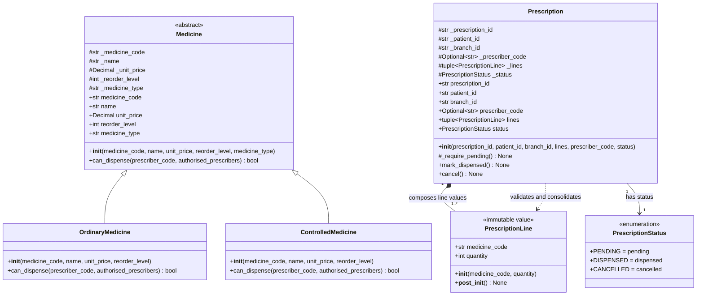

# Member 1 implemented domain UML

This diagram describes `medicine.py` and `prescription.py`, not proposed
database, GUI, inventory, or dispensing-service classes. The public API and
integration examples are detailed in [member1_design.md](member1_design.md).

## Notation and code mapping

- `+` denotes a public API; `#` denotes non-public, single-underscore members.
  Python provides convention-based encapsulation here, not access enforcement.
- `Medicine` is an `ABC`. Its `can_dispense()` method is abstract, and both
  subclasses override it. The two subclasses inherit the parent properties.
- The four mutable medicine properties validate every assignment.
  `medicine_type` is read-only and fixed by each concrete constructor.
- Every public `Prescription` property is read-only. `_require_pending()` is
  an internal guard. `mark_dispensed()` and `cancel()` are the only public
  lifecycle-changing methods.
- In the constructor, `lines` and all subsequent parameters are **keyword-only**.
  This constraint is stated here because the diagram abbreviates signatures.
- `Optional[str]` means `str | None`. The line tuple's exact annotation is
  `tuple[PrescriptionLine, ...]`, with at least one item.
- Composition describes the prescription's owned tuple of immutable line
  values. Construction creates consolidated line values and preserves
  first-seen code order; duplicate codes therefore appear only once.
- `PrescriptionLine` is a frozen, slotted dataclass. Its constructor, equality,
  and hash are generated by `dataclasses`; `__post_init__()` validates inputs.
- Status members' exact persisted strings are `pending`, `dispensed`, and
  `cancelled`. Store `prescription.status.value` rather than its display text.
- A line holds a **medicine code**, not a `Medicine` instance. There is no
  runtime inheritance, composition, or import dependency between those two
  classes. Member 4 resolves that code against medicines and branch stock.
- Module helpers `_validate_text()` and `_validate_identifier()` are functions,
  so they are described in the design notes rather than drawn as classes.

## Lifecycle

| Current status | `mark_dispensed()` | `cancel()` |
|---|---|---|
| `pending` | `dispensed` | `cancelled` |
| `dispensed` | `ValueError` | `ValueError` |
| `cancelled` | `ValueError` | `ValueError` |

All valid statuses may be supplied to the constructor when reconstructing a
persisted record. That construction path is not a dispensing operation and
does not replace transaction-level lifecycle checks.
